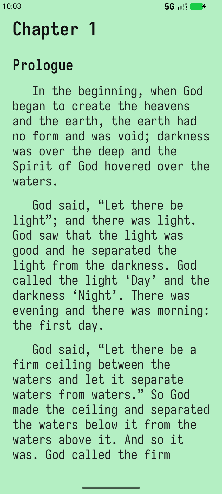
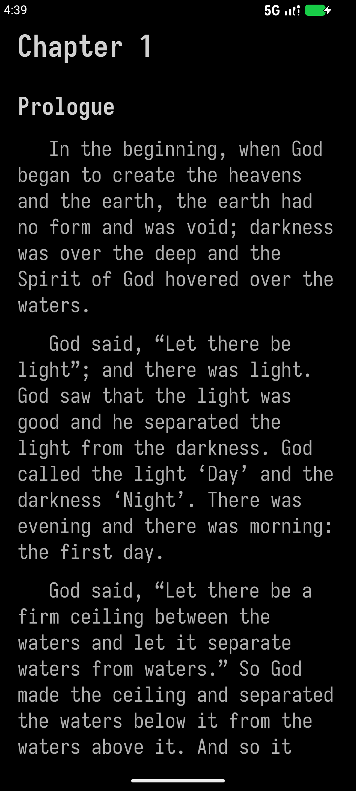
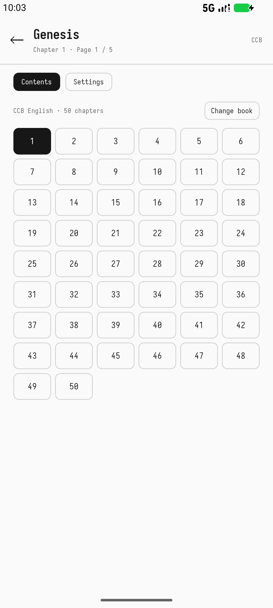
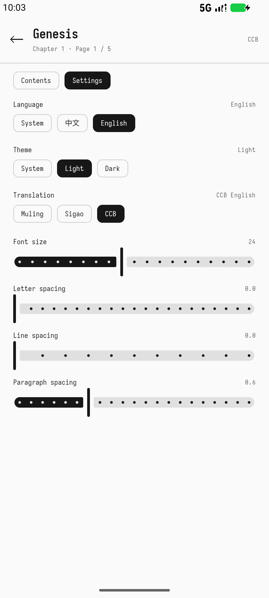

[简体中文](README_zh-CN.md)

# Bible Reader

A quiet, offline Bible reader for Android. Open the app and you are already in the text — no home screen, no account, no network.

<p align="center">
  
  
  
  
</p>

## Highlights

- **Complete offline library** — the 73-book Catholic canon (46 Old Testament + 27 New Testament), bundled with the app.
- **Three translations** — Muling, Sigao, and CCB English. Switch at any time while keeping the current book and chapter.
- **Straight into reading** — the reader opens at your last position; there is no book-list home screen.
- **Full-screen pages** — chapter titles, section headings, and body text use a clear typographic hierarchy. No permanent top or bottom bars.
- **Natural page turns** — swipe left or right and the page follows your finger, including across chapter and book boundaries. A page turn can be started again before the previous animation ends.
- **Screen stays awake while reading** — the display does not time out while the reading view is open; opening the menu, settings, or the book chooser restores the system's normal screen timeout.
- **Volume-key paging** — volume up goes to the previous page, volume down to the next.
- **One menu, three taps away** — tap the center of the screen for a full-screen menu with the chapter grid, book chooser, and settings.
- **Readable typography** — bundled Sarasa Mono SC (regular and bold), adjustable font size, letter spacing, line spacing, and paragraph spacing. Chinese paragraphs use a two-character first-line indent; English paragraphs use a 1.5 em indent.
- **Bilingual interface** — follow the system language or choose Chinese/English manually. The interface, page labels, counts, and settings are localized; Scripture text and book names follow the selected translation.
- **Light, dark, or system theme** — the reading surface and menus support all three. The app's chrome is deliberately monochrome.
- **Your place is remembered** — reading position is saved by character offset and restored across restarts.
- **No network, ads, analytics, or accounts** — the APK contains everything it needs. Android 8.0 (API 26) and newer.

## Reading

- **First launch** opens Genesis, chapter 1. Later launches resume the last page.
- **Previous / next page**
  - Swipe right for the previous page, left for the next page.
  - Or use volume up / volume down.
  - Chapter and book boundaries continue naturally; reaching the last page of a chapter moves into the next chapter.
- **Menu**
  - Tap the center of the screen.
  - Use the chapter grid to jump within the current book.
  - Use **Change book** for the full 73-book list.
  - Use **Settings** for language, theme, translation, and typography.
  - Tap the back arrow or press the system back button to return to reading.

The app opens directly into the reader and keeps the status-bar area free of controls. The center tap is intentionally a small target so ordinary page turns do not open the menu.

## Build

### Requirements

- JDK 17–25. Android Studio's bundled JDK works; Gradle does not rely on a hard-coded JDK path.
- Android SDK Platform **37** and Build Tools **36**.
- The included Gradle wrapper (Gradle 9.8.1). No separate Gradle installation is needed.
- Android Studio is recommended, but only the command line is required.

Set `sdk.dir` in `local.properties`, or open the project in Android Studio and let it create the file:

```properties
sdk.dir=/path/to/Android/Sdk
```

Point Gradle at a supported JDK with Android Studio's Gradle JDK setting, `JAVA_HOME`, or `org.gradle.java.home` in `~/.gradle/gradle.properties`.

### Debug build

```bash
./gradlew :app:assembleDebug
```

Output:

```text
app/build/outputs/apk/debug/app-debug.apk
```

### Release build

Release builds read signing information from `keystore.properties` in the repository root. A signing key is not included in the repository.

Create a key (keep it somewhere safe; losing it prevents future updates):

```bash
keytool -genkeypair -v \
  -keystore keystore/release.jks \
  -alias bible \
  -keyalg RSA -keysize 4096 -validity 10000
```

Create `keystore.properties`:

```properties
storeFile=keystore/release.jks
storePassword=YOUR_STORE_PASSWORD
keyAlias=bible
keyPassword=YOUR_KEY_PASSWORD
```

Build the signed APK:

```bash
./gradlew :app:assembleRelease
```

Output:

```text
app/build/outputs/apk/release/app-release.apk
```

Without `keystore.properties`, the release build falls back to the debug key for local testing. Do not distribute a fallback build.

### Android App Bundle

For Google Play or another store that accepts app bundles:

```bash
./gradlew :app:bundleRelease
```

Output:

```text
app/build/outputs/bundle/release/app-release.aab
```

The bundle is signed with the same release configuration.

### Lint

```bash
./gradlew :app:lintRelease
```

## Project layout

```text
app/
  src/main/java/com/chenyehui/bible/
    MainActivity.kt              Single-activity entry point
    data/                        Reading data, preferences, repository
    ui/                          Compose screens, menu, typography, pagination
  src/main/assets/bible/         Bundled offline Scripture data
  src/main/res/font/             Sarasa Mono SC Regular + Bold
  src/main/res/values*/          App name and theme resources
tools/                           Optional asset, font-subset, and icon scripts
```

All runtime Scripture data and fonts are committed under `app/src/main`. The optional Python tools are only needed to regenerate those assets; a normal build does not run them.

## Tech

- Kotlin
- Jetpack Compose + Material 3
- Single-activity architecture
- Min SDK 26, target/compile SDK 37
- No network permission, no third-party analytics, no ads

## License

The app's source code is released under the MIT License; see [LICENSE](LICENSE).

The bundled Sarasa Mono SC fonts are distributed under the SIL Open Font License 1.1. The license text is included at `app/src/main/assets/licenses/Sarasa-Gothic-OFL.txt`.
