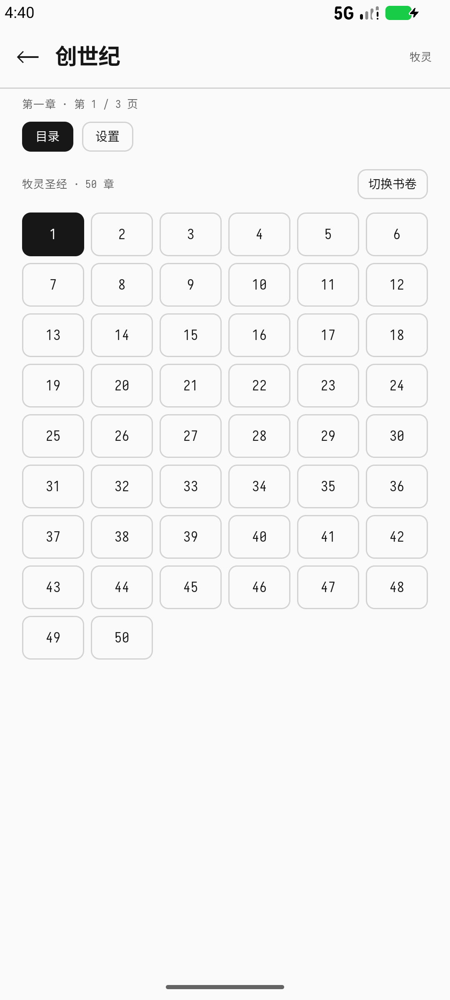
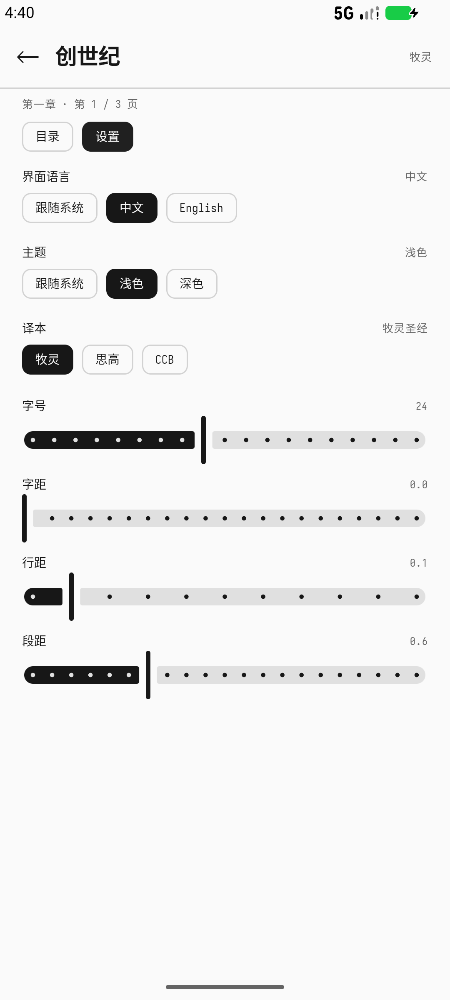

[English](README.md)

# 圣经 · Android 离线圣经阅读器

一个安静、离线的 Android 圣经阅读器。打开就是经文，没有首页、没有账号、不需要联网。

<p align="center">
  
  
  
  
</p>

## 特点

- **完整的离线经库**：73 卷天主教正典（旧约 46 卷、新约 27 卷），全部随应用打包。
- **三套译本**：牧灵圣经、思高圣经、CCB 英文；可随时切换，并保持当前书卷和章。
- **直接进入正文**：启动后回到上次阅读的位置，不经过书卷首页。
- **全屏正文**：章名、小标题和正文有清晰的字号/字重层次，没有常驻顶栏或底栏。
- **自然的翻页**：左右滑动时页面跟随手指；上一次翻页动画还没结束也可以继续翻。
- **音量键翻页**：音量上＝上一页，音量下＝下一页。
- **全屏菜单**：点屏幕正中央打开，包含章节网格、书卷切换和设置。
- **为阅读调整的排版**：内置 Sarasa Mono SC 等宽字体（Regular + Bold），可调字号、字距、行距、段距。中文段首缩进 2 个字符，英文段首缩进 1.5 em。
- **中英双语界面**：可跟随系统，也可手动选择中文或 English。菜单、页码、计数、设置和提示都会切换；经文、圣经书名和章名保持当前译本的语言。
- **亮色 / 暗色 / 跟随系统**：阅读页与菜单都支持；界面主体保持黑白灰。
- **记住阅读位置**：按字符位置保存，重启后回到同一页。
- **无网络、无广告、无统计、无账号**：APK 内含全部资源，支持 Android 8.0（API 26）及以上。

## 使用

- **第一次启动**会打开创世纪第 1 章；之后启动会回到上次阅读的位置。
- **翻页**
  - 向右滑是上一页，向左滑是下一页。
  - 也可以用音量上 / 音量下。
  - 章节和书卷边界会自然衔接；一章最后一页继续翻会进入下一章。
- **菜单**
  - 点屏幕正中央打开。
  - **目录**：当前书卷的章节网格，可直接跳章。
  - **切换书卷**：完整 73 卷列表。
  - **设置**：界面语言、主题、译本、字号、字距、行距、段距。
  - 点左上角返回箭头或按系统返回键回到正文。

应用启动后直接进入正文，状态栏下方不会出现常驻控制栏。中央菜单的点击区域有意做得较小，避免普通翻页时误触。

## 构建

### 环境要求

- JDK 17–25。Android Studio 自带的 JDK 可用；仓库没有硬编码 JDK 路径。
- Android SDK Platform **37** 和 Build Tools **36**。
- 仓库自带 Gradle Wrapper（Gradle 9.8.1），不需要单独安装 Gradle。
- 推荐使用 Android Studio，也可以只用命令行。

在 `local.properties` 里设置 `sdk.dir`，或者用 Android Studio 打开项目让它自动生成：

```properties
sdk.dir=/path/to/Android/Sdk
```

通过 Android Studio 的 Gradle JDK 设置、`JAVA_HOME`，或 `~/.gradle/gradle.properties` 中的 `org.gradle.java.home` 指定受支持的 JDK。

### Debug 构建

```bash
./gradlew :app:assembleDebug
```

输出：

```text
app/build/outputs/apk/debug/app-debug.apk
```

### Release 构建

Release 构建会读取仓库根目录的 `keystore.properties`。仓库本身不包含签名密钥。

创建密钥（请妥善保存；丢失后无法再发布同一应用的更新）：

```bash
keytool -genkeypair -v \
  -keystore keystore/release.jks \
  -alias bible \
  -keyalg RSA -keysize 4096 -validity 10000
```

创建 `keystore.properties`：

```properties
storeFile=keystore/release.jks
storePassword=YOUR_STORE_PASSWORD
keyAlias=bible
keyPassword=YOUR_KEY_PASSWORD
```

构建签名的 APK：

```bash
./gradlew :app:assembleRelease
```

输出：

```text
app/build/outputs/apk/release/app-release.apk
```

如果没有 `keystore.properties`，Release 构建会退回 debug key，仅适合本地测试，不要用于分发。

### Android App Bundle

用于 Google Play 或其他接受 AAB 的商店：

```bash
./gradlew :app:bundleRelease
```

输出：

```text
app/build/outputs/bundle/release/app-release.aab
```

AAB 使用同一套 Release 签名配置。

### Lint

```bash
./gradlew :app:lintRelease
```

## 项目结构

```text
app/
  src/main/java/com/chenyehui/bible/
    MainActivity.kt              单 Activity 入口
    data/                        经文数据、偏好设置、仓库层
    ui/                          Compose 页面、菜单、排版与分页
  src/main/assets/bible/         随 APK 打包的离线经库
  src/main/res/font/             Sarasa Mono SC Regular + Bold
  src/main/res/values*/          应用名与主题资源
tools/                           可选的资源、字体子集和图标脚本
```

运行时需要的经文数据和字体都已提交在 `app/src/main` 下。`tools/` 里的 Python 脚本只用于重新生成这些资源，正常构建不需要运行。

## 技术栈

- Kotlin
- Jetpack Compose + Material 3
- 单 Activity 架构
- minSdk 26，compileSdk / targetSdk 37
- 无网络权限、无第三方统计、无广告

## 许可

应用源代码使用 MIT License，见 [LICENSE](LICENSE)。

内置的 Sarasa Mono SC 字体使用 SIL Open Font License 1.1，许可证文本位于 `app/src/main/assets/licenses/Sarasa-Gothic-OFL.txt`。
